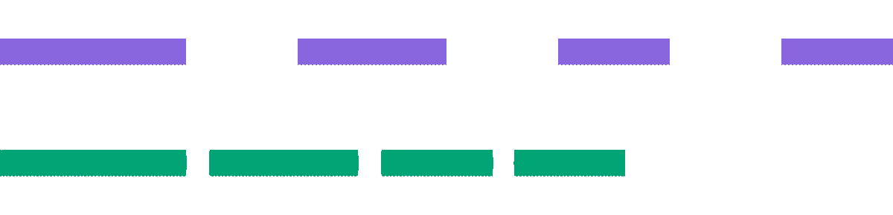

<div align="center">

# ffmpeg-skill-lite

**Let your coding agent cut, de-silence and reframe videos for Shorts with one Python file and local FFmpeg.**

The core of [ffmpeg-skill](https://github.com/kajisho5/ffmpeg-skill) (3.5k stars), the agent video editor, in 271 lines: the same silence cut rule, the same 9:16 sizing rule, and JSON you can check after every step.

Works with **Claude Code** and **Codex**.

 


<sub>Left: the 16:9 input. Right: the output of <code>silence</code> then <code>fit --aspect 9:16 --fit blur</code>. Both are real files from <code>python ffmpeg_lite.py demo</code>.</sub>

</div>

## Quick start
```bash
git clone https://github.com/Dodai0419/ffmpeg-skill-lite && cd ffmpeg-skill-lite
python ffmpeg_lite.py silence talk.mp4 && python ffmpeg_lite.py fit talk_tight.mp4 --aspect 9:16 --fit blur
```
```
{"ok": true, "op": "silence", "output": {"duration": 8.4, "video": {"width": 1280, "height": 720, ...}}, "removed_seconds": 3.6, "cuts": 3}
{"ok": true, "op": "fit", "output": {"duration": 8.4, "video": {"width": 406, "height": 720, ...}}}
```
Needs Python 3.8+ and `ffmpeg`/`ffprobe` on your PATH. No pip packages. No footage is uploaded anywhere.

No clip at hand? `python ffmpeg_lite.py demo` makes a 12-second synthetic clip with three silent gaps and runs every tool on it.

## Gallery

**Silence removal.** Top: the input's audio, 12.0 s with three 1.5 s gaps. Bottom: the output, 8.4 s. Each cut keeps 0.15 s on either side, so words are not clipped:



```bash
python ffmpeg_lite.py silence talk.mp4 --list
```
```
{"ok": true, "op": "silence", "input": 12.0, "silences": [[2.5, 4.0], [6.0, 7.5], [9.0, 10.5]],
 "keep": [[0.0, 2.65], [3.85, 6.15], [7.35, 9.15], [10.35, 12.0]], "kept_seconds": 8.4, "removed_seconds": 3.6}
```

**Vertical for Shorts / Reels / TikTok.** `fit --aspect 9:16 --fit blur` keeps the whole picture in front of a blurred, dimmed copy of itself. Also available: `--fit crop` (fill) and `--fit pad` (bars):


**Look before you say "done".** `look` writes a contact sheet so the agent (or you) can check the picture:


## Tools

| Command | What it does |
|---|---|
| `probe FILE` | Duration, fps, size, codecs and audio layout as JSON. Start every job here |
| `cut FILE --from 2 --to 5` | Lossless stream copy (snaps to the keyframe). Add `--accurate` for a frame-exact re-encode |
| `silence FILE` | Jump-cuts dead air: `--threshold -35` dBFS, `--min-silence 0.6`, `--margin 0.15`, `--min-keep 0.2`. Use `--list` for the plan only |
| `fit FILE --aspect 9:16` | Reframe with `--fit crop|pad|blur`, set `--width/--height`, and hit a `--duration` by `--method speed` (setpts + atempo) or `trim` (`--from-center`) |
| `look FILE` | JPEG contact sheet (`--cols 4 --rows 3`) |
| `demo [DIR]` | Synthetic clip, then silence, fit, look |

Every edit prints one JSON line with the probed output (duration, size, streams), so the agent checks the result instead of assuming it.

## The problem
- Agents that "know FFmpeg" guess a frame rate, build a filter graph by hand and report done without opening the result.
- The full ffmpeg-skill solves this with 42 tools, an MCP server and a contract system: 29,238 lines of Python to read before you can change one rule.
- Most short-form work is the same three steps: cut the dead air, make it vertical, check it.

## The solution
| Idea | Fixes |
|------|-------|
| **The upstream rules, copied as-is**: `keep_ranges()` silence walk, `frame_size()` sizing, select + ametadata audio chain | Same cuts and the same frame sizes as ffmpeg-skill |
| **Typed subcommands, never a shell string** | The agent cannot inject a filter graph or a shell command |
| **Probe after every write**, JSON out | "Done" means measured |

## Use with Claude Code
```bash
/plugin marketplace add Dodai0419/ffmpeg-skill-lite
/plugin install ffmpeg-skill-lite@ffmpeg-skill-lite
```
Then ask: *"Cut the silences out of interview.mp4 and make a 9:16 version for Shorts."*

## Use with Codex (ChatGPT)
```bash
git clone https://github.com/Dodai0419/ffmpeg-skill-lite && cp -r ffmpeg-skill-lite/skills/* ~/.codex/skills/
```
Or copy `AGENTS.md` into your project root.

## Benchmarks

| | ffmpeg-skill | ffmpeg-skill-lite |
|-|-|-|
| lines of Python, excluding tests | 29,238 | 271 |
| tools | 42 | 5 (+ demo) |
| files in repo | 337 | 14 |
| Python dependencies | 0 (stdlib) | 0 (stdlib) |
| `silence --list` on the 12 s demo clip | not measured | 0.90 s |
| `probe` on the 12 s demo clip | not measured | 0.49 s |

Commands: `python -m timeit -n 1 -r 3 ... ffmpeg_lite.py silence talk.mp4 --list` (best of 3) and `-n 3 -r 3 ... probe talk.mp4`. Both include Python start-up and the ffmpeg/ffprobe run. Windows 11, Python 3.11.1, FFmpeg 9.0.2. Upstream LOC from `git ls-files '*.py' | grep -v '^tests/' | xargs wc -l` at commit `1ae1bdf`. Upstream timings are "not measured": this run did not execute the upstream code.

**Parity checks** (`python -m unittest`, 11 tests, about 50 s with FFmpeg installed):
- Ported from upstream `test_editing.py`: `keep_ranges` with a nested span. 1280x720 → 9:16 is **406x720** (bounded by height, not upscaled). `--duration 6 --aspect 9:16 --fit pad --width 540` gives **540x960, 6.0 s**. `--method trim --from-center --aspect 1:1` gives a square 4.0 s clip.
- End to end on a synthetic clip: silence removal keeps the audio and lands within 0.15 s of the planned length. Lossless and accurate cuts, contact sheet, and a clean JSON error for a missing file.

## Not included
Captions and karaoke, overlays, HDR → SDR, loudness, sync, multicam, scene detection, filler-word removal, project rendering, the MCP server and the contract. For those, use [ffmpeg-skill](https://github.com/kajisho5/ffmpeg-skill).

## Inspired by
- [kajisho5/ffmpeg-skill](https://github.com/kajisho5/ffmpeg-skill): the probe → edit → verify workflow, the silence and sizing rules, and the aselect workaround (MIT)

## Roadmap
- [ ] `caption FILE --srt subs.srt` burn-in
- [ ] `loudness -I -14` for platform targets
- [ ] `--dry-run` that prints the FFmpeg command

## License
MIT. Rules adapted from ffmpeg-skill, copyright (c) 2026 kajisho5, MIT (see LICENSE).
